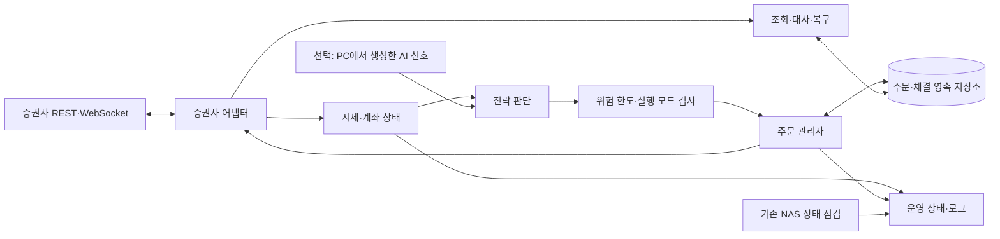

# 프로젝트 정의서

| 항목 | 내용 |
|---|---|
| 프로젝트 | AI_In_Automated_Stock_Trading_System |
| 문서 버전 | 1.1 |
| 작성 | 2026-11-08 11:16 KST |
| 수정 | 2026-11-08 12:53 KST — 역할별 담당과 인계 기준 연결 |
| 상태 | 기존 구현에 대한 기술 인계 + 미구현 영역의 제안 설계 |
| 요청 범위 | [프로젝트 요청서](PROJECT_REQUEST.md) |
| 역할·인계 | [역할별 업무 분장표](WORK_ALLOCATION.md) |
| 현재 구현 근거 | [README](../README.md), [검증 보고](../reports/nas-validation-20261108.json), `nas/`, `deploy/`, `tests/` |

## 1. 문서를 해석하는 기준

- **기존 구현**은 저장소와 이전 배포·검증 기록으로 확인된 내용이다.
- **계획·제안**은 앞으로 구현할 계약과 구성이다. 해당 이름의 모듈·명령·설정이 이미 존재한다는 뜻이 아니다.
- **미정**은 사용자 선택이나 계좌·공식 API 정보가 추가로 필요한 항목이다.
- 문서 작성 시점에는 NAS 운영 설정을 변경하거나 장비를 다시 측정하지 않았다. 03:29 KST 장비 수치는 과거 검증 기준값이다.
- 사용자 후속 지시와 실제 확인한 환경이 달라지면 근거와 영향을 기록하고 문서를 갱신한다. 모의 API의 응답을 실전 체결 특성으로 일반화하지 않는다.

## 2. 현재 구현과 미구현 경계

| 영역 | 현재 상태 | 다음 구현에서 필요한 일 |
|---|---|---|
| NAS 상태 점검 | 구현·배포됨. 최신 JSON 한 개, 5분 주기 | 매매 상태와 연계할 때 대상 데이터 볼륨과 일반 공유 볼륨을 구분 |
| journal 용량 제한 | 구현·배포됨. 검증된 과거 로그 보관본 존재 | 기존 보관 정책 유지 |
| 자원 제한 | 매매용 slice·서비스 템플릿 설치됨 | 실제 애플리케이션을 연결하고 동시 NAS 사용 중 검증 |
| 매매 서비스 | 템플릿만 존재, 비활성. 애플리케이션 없음 | 진입점·의존성·배포 방법 구현 |
| KIS 연동 | 기술 추천만 완료 | 계좌 준비 여부 확인, 경량 어댑터 구현 |
| 시세·전략·주문·DB | 미구현 | 오프라인 테스트부터 구축 |
| AI·백테스트·대시보드·외부 알림 | 미구현 | 후속 범위로 설계 |

## 3. 환경과 경로

### 3.1 장비 기준값

| 항목 | 2026-11-08 검증 기록 |
|---|---|
| 하드웨어 | Raspberry Pi 4, 물리 RAM 약 4GB, OS 보고값 3794MiB |
| OS | Raspbian GNU/Linux 11, OpenMediaVault 6.4.9-1 |
| 아키텍처 | 커널 aarch64, 사용자 환경 armhf/32비트 |
| Python | 버전은 다음 착수 시 `python3 --version`으로 재확인. Python 3.11 이상이라고 가정하지 않음 |
| Docker | 24.0.4, cgroup v2. memory 컨트롤러 비활성 |
| 기존 서비스 | Samba, OMV 엔진, nginx, Docker 등 운영 중 |
| 저장공간 | 루트 ext4 약 25GiB 여유. 일반 공유 볼륨 두 개는 99.88%, 96.13% 사용 |
| 로그·메모리 | 활성 journal 32MiB, `/var/log` 36MiB, 가용 메모리 3460MiB |
| 시각 | 당시 Asia/Seoul, NTP 동기화 확인 |

이 값은 용량 계획의 출발점이다. 소스 다운로드나 패키지 설치 전 실제 여유 공간을 확인하고, 현재 NAS와 동시 실행했을 때의 성능을 별도로 측정한다.

### 3.2 개발·운영 경로

| 용도 | 경로·상태 |
|---|---|
| Windows 개발 폴더 | `Z:\ProJect\AI_In_Automated_Stock_Trading_System` |
| NAS에서 같은 소스가 보이는 경로 | `/srv/dev-disk-by-uuid-38EABECDEABE86A2/KYRNAS1/ProJect/AI_In_Automated_Stock_Trading_System` |
| 상태 점검 운영 파일 | `/opt/nas-trading-tools/healthcheck.py` — 설치됨 |
| NAS 상태 결과 | `/var/lib/nas-healthcheck/status.json` — 배포 시 생성 확인 |
| 향후 매매 진입점 | `/opt/nas-trader/main.py` — 서비스가 참조하지만 아직 없음 |
| 향후 매매 상태·DB 경로 | `/var/lib/nas-trader` — `StateDirectory`로 관리할 계획 |
| 향후 인증 설정 경로 | `/etc/nas-trader/trader.env` — 서비스 참조만 있으며 실제 생성 여부·값은 미확인 |
| 운영 설정 보관 위치 | `/var/backups/nas-trading-maintenance/` — root 전용 |

Z:와 NAS 소스 경로는 같은 파일이다. 이 둘 사이를 별도 사본으로 오인해 덮어쓰지 않는다. 운영 반영은 선택한 파일을 `/opt`, `/etc/systemd` 등에 설치하는 단계다. NAS 접속 비밀번호와 API 키는 이 문서에 기록하지 않는다.

### 3.3 기존 운영 설정

- `nas-healthcheck.timer`: 부팅 후 첫 실행 예약, 이후 약 5분 간격으로 상태 수집.
- `nas-trading.slice`: `CPUQuota=100%`, `TasksMax=64`, 낮은 CPU·I/O 가중치. 4코어 전체 중 한 코어 상당의 CPU 예산이다.
- `nas-trader.service`: `DynamicUser=yes`, `StateDirectory=nas-trader`, `LimitAS=768M`, 실패 시 재시작, `ConditionPathExists=/opt/nas-trader/main.py`. 현재 비활성이다.
- `LimitAS=768M`은 각 프로세스의 가상 주소공간 한도다. 전체 자식 프로세스의 실제 메모리 합계를 강제로 제한하는 기능은 현재 없다.
- `nas/apply.py`는 상태 점검·journal·systemd 파일을 설치한다. **주식 매매 애플리케이션이나 의존성 설치 기능은 없다.** 매매 코드 배포는 별도 범위를 구현하고 검증해야 한다.

## 4. 목표 구성 — 제안



구성 요소는 모듈 경계이며 각각을 별도 컨테이너나 상주 프로세스로 만들 필요는 없다. 첫 구현은 하나의 가벼운 Python 프로세스와 영속 저장소를 우선 검토한다. NAS 파일 공유 서비스는 이 프로그램과 독립적으로 계속 운영한다.

## 5. 모듈과 내부 계약 — 제안

기존 `nas/`는 NAS 관리 도구로 유지한다. 새 매매 코드는 예를 들어 `trading/` 패키지에 둘 수 있다. 아래 파일 배치는 제안이며 아직 생성되지 않았다.

```text
trading/
  main.py                 실행 모드·생명주기·단일 실행 잠금
  config.py               설정 검증·인증정보 로딩
  broker/
    base.py               공통 인터페이스·내부 데이터 모델
    kis.py                KIS 요청·응답 변환·호출 한도 관리
    fake.py               재현 가능한 오프라인 테스트용 증권사
  market_data.py          시세·거래 일정·데이터 최신성
  strategies/             신호 생성 인터페이스와 검증용 단순 전략
  risk.py                 노출·손실·수량 한도·새 주문 중지
  orders.py               주문 상태 전이·조회·대사
  storage.py              영속 기록·마이그레이션
  status.py               상태 결과와 비밀정보를 제외한 운영 기록
```

| 경계 | 전달 데이터 | 중요한 조건 |
|---|---|---|
| 시세 → 전략 | 종목·가격·수신 시각·거래소 시각·시장 상태 | 오래된 데이터·장외 상태를 구분 |
| 전략 → 위험 검사 | 신호 ID·전략 버전·종목·방향·수량/예산·판단 시각 | 주문 전송을 직접 수행하지 않음 |
| 위험 검사 → 주문 관리자 | 승인된 주문 의도·검사 결과·유효 기간 | 한도 누락이나 모드 불일치는 승인하지 않음 |
| 주문 관리자 → 증권사 | 내부 주문 ID와 주문 요청 | 증권사별 필드를 어댑터에서 변환 |
| 증권사 → 저장소 | 주문번호·접수 결과·체결·잔량·조회 시각 | 원본 요청과 연결해 대사 가능 |

가격·금액은 이진 부동소수점 누적 오차를 피할 표현을 사용한다. 계좌번호·종목코드는 선행 0이 유지되는 문자열로 취급한다. 내부 주문 ID와 증권사 주문번호를 별도로 관리한다.

## 6. 모드·설정·증권사 연결 — 제안

### 6.1 실행 모드

| 모드 | 외부 통신·주문 | 용도 |
|---|---|---|
| offline | 가짜 증권사만 사용, 외부 주문 없음 | API 키 없이 기능·장애 시나리오 검증 |
| paper | 증권사의 모의투자 서버와 모의 계좌만 사용 | 인증·조회·모의 주문 통합 검증 |
| live | 실계좌 환경 | 초기 구현의 실행·검증 범위에서 제외 |

API 통신을 하는 기본 모드는 paper로 설계한다. 키가 없거나 환경이 맞지 않으면 실행을 실패시키며 live로 자동 전환하지 않는다. offline은 명시적으로 선택하고, 가짜 결과를 모의 서버 검증 결과로 표시하지 않는다.

### 6.2 설정 항목

다음은 구현할 설정 계약의 예시다. 현재 저장소에 설정 로더나 해당 환경변수가 구현됐다는 뜻은 아니다.

| 항목 | 설계 기준 |
|---|---|
| 실행 모드·증권사 | 중앙 설정 한 곳에서 결정하고 서버 주소·계좌·키의 환경 일치를 검사 |
| App Key·App Secret·계좌 식별값 | 보호된 운영 설정에서 읽으며 문서·로그·예외 출력·Git에 값을 남기지 않음 |
| 호출 한도 | 계좌·상품·API별 최신 공식 제한을 확인해 설정. 조회·재연결·토큰 재발급도 제어 |
| 종목군·주기·거래 일정 | 초기 국내 현물 가정으로 개발하되 설정으로 분리하고 공식 거래 일정 확인 |
| 위험 한도 | 주문당 금액, 종목별·총 노출, 보유 종목 수, 일일 손실 한도 등. 필요한 값 미설정 시 주문 금지 |
| 저장소·로그 | 운영 상태 경로, 보관·크기 제한, 시간대가 있는 시각 |

공식 Python 예제 저장소는 조사 시점에 Python 3.11 이상을 요구했다. 현재 NAS에 전체 예제 환경을 그대로 설치할 수 있다고 가정하지 않는다. 실제 인터프리터를 확인한 후 필요한 REST·WebSocket 기능과 의존성만 선택하고, 버전 변경이 필요하면 NAS 영향과 대안을 먼저 구체화한다.

수수료, API 호출 한도, 토큰 만료, 모의투자 지원 API는 변경될 수 있다. 구현 시 공식 문서와 계좌 조건을 확인하고 확인 날짜를 남긴다. 수수료 이벤트가 API 주문에 적용된다고 추정하지 않는다.

## 7. 주문·기록·복구 — 제안

### 7.1 저장할 핵심 정보

- 실행 세션: 모드, 시작·종료 시각, 소스·전략 버전, 비밀정보를 제외한 설정 식별값.
- 신호·주문 의도: 내부 ID, 종목, 방향, 수량·가격 조건, 위험 검사 결과.
- 증권사 주문: 증권사 주문번호, 접수·거절, 체결·잔량, 취소 진행 상태.
- 계좌 상태: 잔고·보유·주문 가능 금액의 조회 시각과 스냅샷.
- 복구·운영 사건: 타임아웃, 재연결, 상태 대사 결과, 비상 중지와 중지 해제 근거.

초기 저장소는 로컬 ext4 위 SQLite 등을 검토한다. RAM 임시 경로, SMB 공유를 통해 접근하는 DB, 공유 NTFS 볼륨을 기본 주문 DB로 선택하지 않는다. 실제 경로·쓰기 빈도·백업·마이그레이션을 검증하며 microSD의 내구성도 고려한다.

### 7.2 상태 전이와 결과 불명 처리

```text
CREATED → APPROVED → SUBMITTING → ACKNOWLEDGED → PARTIALLY_FILLED → FILLED
                             ↘ RECONCILIATION_REQUIRED
확인된 거절 → REJECTED
취소 요청 → CANCEL_PENDING → 확인된 취소 → CANCELLED
```

증권사 응답에 따라 일부 상태를 건너뛰는 경우를 처리한다. 취소 요청 접수와 최종 취소 확정을 구분하며, 부분체결 후 잔량 취소도 기록한다.

주문 의도와 전송 직전 상태를 먼저 영속화한다. 주문 전송 후 응답이 없으면 결과 불명 상태로 두고 조회·대사를 수행한다. 미체결 목록에 없다는 사실만으로 주문 실패를 단정하지 않는다. 대사 결과가 불확실하면 해당 주문의 재전송과 새 노출 증가를 중단하고 원인을 표시한다.

중복 방지는 단순한 로컬 ID 발급만으로 완료되지 않는다. 증권사의 멱등성 지원 여부, 조회에서 주문을 대응시킬 수 있는 필드, 부분체결·세션 재시작 조건을 함께 검증한다. 동일 프로세스의 중복 실행도 잠금으로 막는다.

## 8. 운영 상태와 NAS 공존

- 기존 상태 점검의 `critical`은 장비 관측 결과이며, 점검 서비스 자체 실패와 다르다. 공유 디스크 용량 부족만으로도 현재 상태는 critical일 수 있다.
- 향후 매매 중단 판단에서는 주문 DB·로그가 저장되는 볼륨과 일반 NAS 공유 볼륨을 구분한다. 공간 부족·쓰기 실패·저장소 손상이 발생한 매매 데이터 경로에서는 새 주문을 만들지 않는다.
- 마지막 시세 수신·계좌 조회·대사 시각, 연결 상태, 실행 모드, 미체결 수, 새 주문 허용 여부와 중지 사유를 제공한다.
- 비상 중지는 우선 새 주문을 차단한다. 미체결 취소·보유 청산은 별도 동작으로 정의하고, 중지 명령을 무조건 전량 매도와 같은 뜻으로 사용하지 않는다.
- 외부 알림 채널과 웹 화면은 현재 없다. 첫 단계는 로컬 상태 JSON·CLI·systemd 로그로 운영 결과를 확인할 수 있게 한다.
- 로그는 크기·보관 기간을 제한한다. NAS의 journal 최적화와 folder2ram 구조를 우회해 다른 위치에 무제한 로그를 만들지 않는다.

기존 미해결 항목은 일반 공유 디스크 두 개의 공간 부족, 비활성 memory cgroup, `systemd-networkd-wait-online` 실패 기록이다. 현재 작업자는 착수 시 상태를 확인하고 본인 작업과의 의존성을 판단한다. 데이터 정리·OS 교체·부팅 변경을 매매 구현의 부수 작업으로 임의 수행하지 않는다.

## 9. 작업 분해와 협업 경계

다음은 여러 작업자가 나누어 진행할 수 있는 작업 단위다. **현재 담당자가 배정되었다는 뜻은 아니다.** 착수자는 작업 ID, 담당 파일, 의존성, 완료 근거를 작업 기록에 남긴다.

역할별 상세 업무·산출물·검토·첫 지시는 [역할별 업무 분장표](WORK_ALLOCATION.md)를 따른다. 아래의 주담당은 역할 기준이며, 디자인·감사·문서는 여러 작업에 걸쳐 독립 업무를 수행한다.

| ID | 작업 | 주담당 역할 | 주요 파일 범위 제안 | 의존성 | 완료 근거 |
|---|---|---|---|---|---|
| T0 | 환경·공식 API 조건 재확인 | OPS, API 근거는 RES 지원 | 환경 기록·정의서 | 없음 | Python·아키텍처·저장소·공식 조건 확인 기록 |
| T1 | 설정·공통 모델·가짜 증권사 | DEV | `trading/config.py`, `trading/broker/base.py`, `fake.py` | T0 | 키 없이 offline 실행, 환경 불일치·비밀정보 제외 검증 |
| T2 | KIS 어댑터 | DEV | `trading/broker/kis.py` | T1 | 가짜 HTTP 응답 테스트, 키 준비 후 모의 조회 검증 |
| T3 | 영속 저장·주문 상태·대사 | DEV | `trading/storage.py`, `orders.py` | T1 | 재시작·부분체결·결과 불명·중복 방지 테스트 |
| T4 | 위험 한도·전략 인터페이스 | DEV | `trading/risk.py`, `strategies/` | T1 | 한도 초과·미설정·중지 시 주문 차단 검증 |
| T5 | 시세·스케줄·운영 상태 | DEV, 정보 설계는 DES 지원 | `trading/market_data.py`, `status.py` | T1, T2 | 오래된 시세·휴장·재연결·상태 출력 검증 |
| T6 | 통합·모의투자 검증 | DEV, 독립 검토는 AUD | `trading/main.py`, 통합 테스트 | T2~T5 | 모의 주문·체결·취소·장애 복구 증거 |
| T7 | NAS 배포·회귀·복구 | OPS, 안내는 DOC 지원 | 배포 도구·운영 문서 | T6 | NAS 실기 실행, 기존 파일 공유 정상, 자원·복구 확인 |
| T8 | AI 확장 설계 | RES | 모델·데이터·검증 계획 | T6 이후 | 오프라인 성능과 운영 비용·자원 요구 근거 |

공통 모델·DB 스키마·설정 계약 변경은 관련 작업자와 먼저 조율한다. 별도 checkout이나 브랜치를 사용할 수 있으면 활용하며, 같은 SMB 소스 파일을 동시에 덮어쓰지 않는다. `UPDATE.md`와 `OWERORDER.md`는 기존 기록을 보존하면서 본인 작업을 추가한다.

### Git 상태 주의

문서 작성 시 공유 폴더의 `.git`은 HEAD가 없는 미완성 상태이고 `config.lock`이 남아 있다. 이 잠금을 임의 삭제하거나 기존 메타데이터를 초기화하지 않는다.

앞선 반영에서는 원격 최신 main을 별도 임시 Git 메타데이터로 받아, 이 공유 폴더에서 검증한 파일만 지정해 커밋했다. GitHub 연결 도구의 쓰기는 당시 403으로 실패하여 PC의 기존 Git 인증을 사용했다. 다음 작업자는 현재 접근 권한을 다시 확인하되 인증값을 출력하지 않는다.

변경 전 원격 파일과 작업 파일을 비교하고 타 작업자의 변경을 보존한다. 푸시가 거부되면 원격 변경을 확인해 통합하며 강제 푸시로 해결하지 않는다. 검증한 파일만 반영하고 출처가 불분명한 파일을 일괄 추가하지 않는다.

별도 bare clone을 Git 메타데이터로 사용할 때는 작업 파일을 추가하기 전에 **그 별도 메타데이터의 index를 기준 커밋으로 채운다**. 예를 들어 `git --git-dir=<별도 Git 경로> read-tree HEAD`를 사용하며 작업 파일을 변경하는 `-u` 옵션은 사용하지 않는다. 빈 index에서 일부 문서만 추가하면 기존 소스가 삭제된 커밋이 만들어질 수 있다. 커밋 전 변경 파일 목록이 의도한 목록과 정확히 일치하는지 확인한다. 기존 공유 폴더의 미완성 `.git`에서 이 작업을 수행하지 않는다.

## 10. 검증·배포·복구

### 10.1 기존 검증 명령

아래는 현재 NAS 운영 도구에 대한 명령이다. 아직 없는 매매 모듈을 검증하거나 설치하는 명령이 아니다.

```sh
python3 -m unittest discover -s tests -v
python3 -m compileall -q nas tests
sudo python3 nas/apply.py --check
sudo cat /var/lib/nas-healthcheck/status.json
systemctl is-active smbd nginx docker openmediavault-engined nas-healthcheck.timer
sudo journalctl --disk-usage
```

`sudo python3 nas/apply.py --apply`는 기존 NAS 설정을 실제 변경할 수 있는 배포 명령이다. 문서 작성이나 조회만 하는 작업에서 실행할 필요는 없다. Windows에서는 Linux 전용 배포 테스트 두 개가 제외되므로 Windows 검사만으로 NAS 테스트 9개가 모두 통과했다고 기록하지 않는다.

### 10.2 신규 핵심 검증

| 분류 | 필수 시나리오 |
|---|---|
| 설정·인증 | 누락·만료·모드 불일치·토큰 재발급 실패·출력에 비밀정보 없음 |
| 시세·시간 | 데이터 지연·역순·연결 단절·휴장·장 종료·시간대 처리 |
| 주문·저장 | 전송 전 기록, 거절, 부분체결, 취소 확정, 응답 소실, 재시작, 중복 실행, DB 쓰기 실패 |
| 위험 한도 | 한도 미설정·초과, 오래된 계좌 정보, 주문 중지, 결과 불명 주문 존재 시 동작 |
| 통합 | 가짜 증권사에서 재현, 실제 모의 서버에서 지원되는 기능 확인, 실계좌 주문 요청이 없음 |
| NAS 공존 | 실제 매매용 경로 읽기·쓰기, 자원 한도 실효값, 매매 부하와 파일 공유를 함께 실행한 측정·서비스 상태 |

모의 서버 지원 범위와 미지원 항목을 검사 결과에 명시한다. 거래비용·슬리피지·실제 체결 가능성을 모의투자 결과만으로 입증했다고 설명하지 않는다.

### 10.3 배포와 되돌리기

1. 적용할 소스·설정과 이전 버전을 식별하고, 대상 경로와 DB 백업·마이그레이션 여부를 확인한다.
2. 애플리케이션·의존성을 함께 설치하는 재현 가능한 절차를 작성한다. 저장소 모듈과 `/opt/nas-trader/main.py` 진입점의 import·경로 관계를 검증한다.
3. 현재 서비스는 `/usr/bin/python3`를 사용한다. 가상환경이 필요하면 ExecStart 변경과 `DynamicUser`의 읽기·상태 경로 쓰기 권한까지 검증한다.
4. 초기 배포는 offline 또는 paper를 명시하고 로그·상태·NAS 파일 공유·자원 제한을 확인한다.
5. 실패 시 새 주문을 중단하고 애플리케이션·설정을 이전 버전으로 복원한다. DB 스키마가 바뀌었다면 데이터 복구 절차도 검증한다.
6. 검증 결과, 배포한 버전, 미검증 항목, 복구 방법을 기록하고 GitHub에 반영한다.

이전 NAS 로그 보관본과 배포 manifest의 정확한 위치는 [README 복구 안내](../README.md#되돌리기)와 [장비 검증 결과](../reports/nas-validation-20261108.json)를 참조한다. 최초 적용이 실패했던 manifest의 `completed=false`와 과거 로그 보관본의 유효성을 혼동하지 않는다.

## 11. 미정 사항과 착수 시 확인할 정보

| 항목 | 지금 확인된 상태 | 처리 방향 |
|---|---|---|
| KIS 계좌·모의 계좌·API 키 | 준비 여부 미확인 | 사용자가 공식 경로에서 준비. 값은 보호된 운영 설정에서 관리 |
| 시장·종목·주기·전략 | 국내 현물 우선 가정만 있음 | 설정·인터페이스부터 개발하고 미정 조건을 완료 기준으로 임의 확정하지 않음 |
| 투자금·손실 한도 | 미정 | 모의 검증용 설정과 실거래용 판단을 구분. 운영상 필요한 값 누락 시 새 주문 금지 |
| NAS의 실제 Python·패키지 호환 | 버전 재확인 필요 | 장비에서 가벼운 구성부터 확인하고 OS 전환을 전제로 개발하지 않음 |
| AI 데이터·모델·학습 자원 | 미정 | S5/T8에서 검증 가능한 제안 작성 |
| 알림·화면·외부 접속 | 미정 | 로컬 상태 확인을 먼저 구현하고 외부 공개를 전제로 하지 않음 |

## 12. 공식 참고 자료

증권사 추천 조사일은 2026-11-08이다. 구현 시 아래 공식 자료의 최신 내용을 다시 확인한다. 수수료·유량·제한을 문서 작성 당시의 값으로 고정하지 않는다.

- [KIS API 구조·실전/모의 서버](https://apiportal.koreainvestment.com/apiservice-summary)
- [KIS 이용 신청 안내](https://apiportal.koreainvestment.com/about-howto)
- [한국투자증권 공식 Python 예제와 요구 환경](https://github.com/koreainvestment/open-trading-api)
- [KIS 서비스 공지사항](https://apiportal.koreainvestment.com/community/10000000-0000-0011-0000-000000000001)
- [키움 REST API 이용·허용 IP 등록 안내](https://openapi.kiwoom.com/intro/serviceInfo)
- [LS증권 OPEN API 신청 안내](https://openapi.ls-sec.co.kr/about-openapi)
